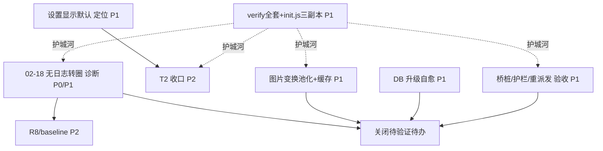

# animeVenera 架构方案与剩余计划（架构师：高见远）

> **TL;DR**：骨架已健康——桥桩/手动翻页/设置重派发三块"已修待验证"，剩余真正的活是**两处未定位事故的诊断（02-18 无日志无限转圈、设置显示默认）+ 三处未做优化（图片变换池化+哈希缓存、DB 升级自愈、R8/baseline）**，全部按"先诊断→再实施→真机验证收口"推进，且任何改 JsMessageDispatcher/init.js 的动作都先跑 23 个 verify_*.js。

---

## 一、模块架构与分层

### 1.1 模块边界（自底向上五层）

```
┌──────────────────────────────────────────────────────────────────────────┐
│  L0  源仓库 / 本地源脚本                                                    │
│   • venera-configs/index.json + *.js（远程仓库，JsSourceUpdater 拉取）       │
│   • filesDir/comic_source/<key>.js + <key>.data（本地落地，约 2692–2694 条） │
└───────────────────────────┬──────────────────────────────────────────────┘
                              │ install / updateInstalled / loadFrom
┌─────────────────────────────┴─────────────────────────────────────────────┐
│  L1  胶水层 init.js（三份副本，必须同步）                                   │
│   vendor/js-source/init.js                                                 │
│   js-source/src/main/assets/init.js                                        │
│   ref-quickjs-android/samples/init.js                                      │
│   → 提供 BRIDGE_SHIM（sendMessage→Promise）、Network/Image/Convert/UI 桥、   │
│     compute 显式"不支持"、__delay_async 改写、__SYNC_METHODS 裸值返回        │
└───────────────────────────┬──────────────────────────────────────────────┘
                              │ 在 QuickJS context 内解释执行
┌─────────────────────────────┴─────────────────────────────────────────────┐
│  L2  js-source 模块（:js-source，Kotlin）                                   │
│   ├─ JsEngine           单线程 QuickJS runtime；evalBlocking/evalAwaiting/  │
│   │                      deliverHttp/claimDialogActionsInline/invokeDialog │
│   ├─ JsMessageDispatcher 桥 K 侧：dispatch 所有 sendMessage 方法           │
│   │   ├─ http / __http_async / __delay_async（异步腿，不钉 JS 线程）       │
│   │   ├─ convert（base64 BOM / AES NoPadding 短尾 / hmac key 在前）        │
│   │   ├─ cookie（接 network.cookieJar） / log（转 Logcat）                 │
│   │   ├─ html → JsHtmlBridge   image → JsImageEngine                      │
│   │   └─ UI / load_setting / load_data …  compute=显式不支持               │
│   ├─ JsMangaSource / JsCatalogueSource  实现 Aniyomi MangaSource 接口      │
│   │   └─ initGate(CompletableDeferred) / warmMeta 缓存 / lastKnownMaxPage  │
│   ├─ JsImageEngine      像素变换（register→eval modifyImage→copy-out）      │
│   ├─ JsSourceManager    注册表+加载器+设置/账号持久化+init 调度             │
│   ├─ JsSourceUpdater    仓库 index.json 拉取 + isRepoNewer 版本门          │
│   ├─ JsHtmlBridge       句柄式 DOM（Jsoup）                                │
│   └─ JsDebugLog / JsUiEvents  浮层诊断 + UI 事件投递                       │
└───────────────────────────┬──────────────────────────────────────────────┘
                              │ 并入 sourcesMapFlow，零 UI 改动
┌─────────────────────────────┴─────────────────────────────────────────────┐
│  L3  aniyomi 基座（Kotlin/Compose，Apache-2.0）                            │
│   • MangaSource/CatalogueSource 抽象、AndroidMangaSourceManager            │
│   • UI：BrowseMangaSourceScreenModel（手动翻页护栏）、MangaScreenModel、   │
│     JsSourceConfigScreenModel、JsSourcesScreenModel                        │
│   • DB（tachiyomi.db）、NetworkHelper、CookieJar、下载器                    │
└───────────────────────────┬──────────────────────────────────────────────┘
                              │ 测试台
┌─────────────────────────────┴─────────────────────────────────────────────┐
│  L4  ref-quickjs-android 台子（wrapper-android:3.2.0 + 23 个 verify_*.js） │
│   → 改桥/改 init.js 后的回归基线                                           │
└──────────────────────────────────────────────────────────────────────────┘
```

### 1.2 关键类职责与调用方向

| 类 | 职责 | 调用方向 |
|---|---|---|
| **JsEngine** | 持有唯一 QuickJS context + 单线程 executor；所有 eval 都在这条线程 | 被 JsSourceManager / JsMangaSource / JsImageEngine / JsMessageDispatcher 调用 |
| **JsMessageDispatcher** | `sendMessage({method})` 的 K 侧 switch；运行在 JS 线程 | 被 JsEngine 在 `evaluate()` 内回调；回调 OkHttp bridgeClient / JsHtmlBridge / JsImageEngine / JsSourceManager |
| **JsMangaSource** | 包装成 Aniyomi 的 `MangaSource`；`getMangaDetails/getChapterList/getImage` 泵入引擎 | 被 L3 的 ScreenModel 调用；内部调 JsEngine + JsImageEngine |
| **JsImageEngine** | 像素变换（decode→eval modifyImage→encode），`transformLock` 串行 | 被 JsMangaSource.getImage 调；eval 经 JsEngine 回到 JS 线程 |
| **JsSourceManager** | 扫描 comic_source/*.js 注册、warmMeta 缓存、调度 init()、设置/数据持久化、UI 桥事件 | 持有 JsEngine；被 JsSourceUpdater / UI ScreenModel 调 |
| **JsSourceUpdater** | 仓库 index.json 拉取、`isRepoNewer` 版本门、installFromRepo | 调 JsSourceManager.install |
| **JsHtmlBridge** | 句柄式 DOM（Jsoup），handle 注册表随 runtime 消亡 | 被 JsMessageDispatcher.html 调 |

**典型调用链（浏览翻页）**：
`BrowseMangaSourceScreenModel.loadManualPage` → `JsCatalogueSource.getPopularManga` → `JsMangaSource` 泵 `ComicSource.sources[k].load()`（经 JsEngine 在 JS 线程 evaluate）→ `jm.js` 内 `Network.fetch` → `sendMessage({method:'http'})` → `JsMessageDispatcher` → bridgeClient(OkHttp) → 回包 JSON → JS 解析 → 返回 mangas。

**典型调用链（图片变换）**：
`JsMangaSource.getImage`(IO) → `JsImageEngine.transform` → `decode`(Bitmap) → `JsEngine.evalForValueBlocking("(function(){...modifyImage(new Image(k))})()")`(JS 线程跑 modifyImage) → `copy-out` 像素 → `encode`(PNG) → 返回字节。

---

## 二、剩余问题清单（按 P0/P1/P2，含 file:line 证据与状态）

| 优先级 | 问题 | 证据（file:line） | 当前状态 |
|---|---|---|---|
| P1 | **桥桩（cookie/convert/delay/log/html）** | `JsMessageDispatcher.kt:818`(cookie 接 cookieJar)、`:596`(convert 健壮)、`:331`(delayAsync)、`:250`(log→Logcat)、`:578`(html→JsHtmlBridge)、`:864`(compute 显式不支持) | **已修待验证** —— 代码已落地、debug 构建通过，缺真机验收 |
| P1 | **手动翻页护栏** | `BrowseMangaSourceScreenModel.kt:349-481`：`manualLoadJob?.cancel()`(L353)、代数守卫 `manualLoadGeneration`(L352/381)、`MANUAL_PAGE_TIMEOUT_MS=60_000`(L148)、分阶段日志 `loadManualPage: start/source returned/done/TIMEOUT/failed`(L358/403/439/377/456)、watchdog(L375-394) | **已修待验证** —— 待真机验证 02-18 同类"跳页转圈"是否已被护栏兜住 |
| P1 | **设置重派发（saveSetting 重跑 init）** | `JsSourceManager.saveSetting` L767-775：`initDone.remove(key)` + `scheduleSourceInit(key)`，使 imageStream/apiDomain 改动无需重启生效 | **已修待验证** —— 待安装真机确认"改了配置立即生效" |
| **P0/P1** | **02-18 无日志无限转圈（筛选选标签后跳页）** | 卡点在求值泵之前：相关 `JsMangaSource.initGate`(L81) + `withTimeoutOrNull(90_000){initGate.await()}`(L555)；`loadManualPage`(L349)；期间出现第二次 `jm.init()`(疑似 importData) 与 vivo ROM 进程 swap（零日志新 pid）；>300s 无 JsEngine 日志、无 OkHttp 请求、无 timeout 日志 | **未定位** —— 需复现+全量 logcat 定位（疑似 initGate 调度/ROM 进程管理，非引擎求值本身） |
| **P1** | **设置显示默认（显示索引而非域名）** | 候选：`JsSourceConfigScreen.kt` / `JsSourceManager.parseSettingItem`(L601-644) / `settingValue`(L739)；jm.js `apiDomain` 选项声明（仅 value、无 text）。"重启后显示默认"指持久化回显未生效 | **未定位** —— 待确认属源声明问题还是 UI 回显/restore 问题 |
| P1 | **图片变换串行在 JS 线程** | `JsImageEngine.transform` L168-222：`synchronized(transformLock)`(L182) + `evalForValueBlocking`(L199) 在 JS 线程跑 modifyImage；`handle` 也 `synchronized(lock)`(L86) | **未做** —— 流畅度瓶颈，打散图（jm/goda）翻页阻塞列表/详情请求 |
| P1 | **DB 升级不自愈（S41）** | `MangaScreenModel.kt:225` `needRefreshChapter = chapters.isEmpty()`；已入库漫画章节非空 ⇒ 永不回源重拉；彻底修需给 manga 加"上次同步源版本"字段+DB 迁移(2700+ 风险) | **未做** —— 当前下拉刷新是唯一修乱序入口 |
| P2 | **R8 / baseline profile** | `app/build.gradle.kts:51-58`：`isMinifyEnabled = Config.enableCodeShrink`、`isShrinkResources` 同；`baselineProfile` 生成任务未绑定；debug 包本就不开 R8 | **未做** —— 仅 release 可做，需真机 macrobenchmark |

> 说明：`compute` 已按架构判定"显式不支持"（S5 函数跨桥被丢弃 + S2 context 只能由创建线程触碰），当前索引无源使用，不在待办内，仅保留日志告警。

---

## 三、流畅度提升方案（"还能提升多少"）

**总判断**：此前卡顿主因（主线程 eval、每次重组重算、withFrameNanos 常驻）已消除，切页/切 tab 的体感应已大幅改善。剩余收益属于**"更跟手"而非"从卡到不卡"**，且受 S2/S16 硬约束限制——**modifyImage 的 eval 必须留在 JS 线程，不能跨线程碰 context，也不能持锁跨 eval**。

| 优化项 | 现在 | 方案（守约束） | 预期收益 | 风险 |
|---|---|---|---|---|
| **图片变换解码/编码卸载** | decode(BitmapFactory)+encode(PNG compress) 在 reader IO 线程，且 eval 钉 JS 线程 | 把 decode/encode（**不 eval、不碰 context**）移到专用单线程池；modifyImage eval 仍留 JS 线程 | IO/reader 线程释放 Bitmap CPU；翻页预取吞吐略升 | 低（纯原生，不碰引擎） |
| **内容哈希缓存** | 同页每次都重跑 modifyImage | 以 `(sourceKey, comicId, epId, sha256(原图))` 缓存最终 PNG 字节；容量上限+TTL；**源版本变更清缓存** | 复看/回滚同一页 ≈ 0 次重新 eval；打散图源翻页"更顺"的最大单项收益 | 中（需内存上限+失效策略，避免 OOM） |
| **per-source 独立 runtime** | 单一共享 JS 线程 | **结论：暂不采用**。每源一个 QuickJS=多线程+多份 init()（2692 源 init 成本/内存爆炸），且仍受 S2 | — | 高（S2/内存/启动成本），仅作研究项 |
| **首启 / 切 tab（baseline profile）** | 依赖 profile 是否打入 | release 开 R8 + 跑 macrobenchmark 生成并打入 baseline-prof.txt | 冷启、首次导航代码路径预估 **10–20% 更快**（需真机量帧确认） | 中（R8 可能误删反射/JS 相关，需 keep 规则） |
| **升级自愈** | 见 S41，老漫画不重拉 | 提供"按源强制重同步"入口 / 升级后标记该源 manga 需重拉（轻量 UPDATE，非全量迁移） | 消除"以为没修好"的反复拉取与困惑（UX 项，非纯性能） | 低-中（大批量写需事务+进度） |
| **导航切换** | warmMeta 已缓存、initGate 只完成一次 | 确认切 tab 不重复 eval（已满足）；保持 S33 轻转场 | 切底部导航不顿（已基本达成） | 低 |

**量化小结**：
- 硬上限仍在——单页 modifyImage eval 约数十~百 ms，30 页章节 ≈ 1.5–4.5s JS 线程时间（无法并发，因共享单线程）。**缓存把"复看"打到 0**，是感知最强的提升。
- decode/encode 卸载对"首看"有小幅释放，不解决 JS 线程 pin 的本质上限，但降低 reader IO 线程竞争。
- baseline profile 仅影响首启/首切，属"锦上添花"，且 debug 包测不到（不开 R8）。

---

## 四、带依赖关系的任务拆解（有序、标依赖）

> 规则：每个任务写清"改哪些文件 + 验证手段"。"已修待验证"三块并入 T7 验收批次。

| ID | 任务 | 改/查文件 | 依赖 | 优先级 | 验证手段 |
|---|---|---|---|---|---|
| **T1** | **02-18 无日志无限转圈 — 根因诊断** | `JsMangaSource.kt`(initGate L81/555, getImage/getMangaDetails eval)、`BrowseMangaSourceScreenModel.kt`(loadManualPage L349)、`JsEngine.kt`(eval pump/executor)；加 initGate await 起止、executor 入队/出队、watchdog 命中日志 | 无 | P0/P1 | vivo 真机复现 + 从启动拉全量 logcat；确认"卡在 eval pump 之前"证据链；产出根因结论 |
| **T2** | **设置显示默认（索引而非域名）— 定位** | `JsSourceConfigScreen.kt`、`JsSourceManager.parseSettingItem`(L601-644)/`settingValue`(L739)、jm.js `apiDomain` 选项声明 | 无 | P1 | 改 apiDomain 后重启，确认 UI 显示所选域名而非默认索引 |
| **T3** | **图片变换：解码/编码卸载 + 内容哈希缓存（不碰 context）** | `JsImageEngine.kt`(transform L168-222, decode L292, encode L308)、`JsMangaSource.getImage`（调用点）、新增 `ImageTransformCache.kt` | 无（与 T1 不互斥，可并行） | P1 | `verify_image_scramble_e2e.js` 不回归；真机 jm 打散图翻页 JankStats 对比；复看同页命中缓存=0 次 eval |
| **T4** | **DB 升级自愈：按源强制重同步入口（规避 2700+ 迁移）** | `JsSourceUpdater.kt`(updateInstalled L213)、`MangaScreenModel.kt`(L225)、新增 UI 入口 + 仅该源 manga 置需重拉（轻量 UPDATE） | 无 | P1 | 升级 jm.js(乱序修复版)→老漫画自动重拉顺序正确；`adb run-as` 拉 `tachiyomi.db` 字节核对 |
| **T5** | **R8 / baseline profile（release 优化）** | `app/build.gradle.kts`(L51-58)、`macrobenchmark` 模块、`baseline-prof.txt` | T1 结论后更稳（确认无主线程 eval 残留）；可并行 | P2 | release 包首启/切 tab JankStats；APK 体积对比 |
| **T6** | **T2 收口：按结论修源声明或 UI** | 视 T2 结论（jm.js 三副本同步 / `JsSourceConfigScreen.kt`） | T2 | P2 | 重启回显正确；注意 init.js 三副本同步约束 |
| **T7** | **验收收口：桥桩 / 手动翻页护栏 / 设置重派发（关闭"待验证"待办）** | `JsMessageDispatcher.kt`、`BrowseMangaSourceScreenModel.kt`、`JsSourceManager.saveSetting`(L767-775) | 无（独立验收） | P1 | 跑 23 个 verify_*.js + 真机：cookie 持久/log/convert/delay 正常；跳页超时兜住；改 apiDomain 立即生效 |
| **T8** | **回归基线：全套 verify_*.js + 三副本 init.js 一致性** | `ref-quickjs-android/verify_*.js`(23)、`init.js` 三副本 | 每个代码改动前/后 | P1 | 本地 node 跑全套，0 失败；三副本 diff 一致 |

**依赖关系图**（mermaid）：



> 关键依赖（按 team-lead 示例）：**T1 阻塞 T5 与 T9（流畅度收尾）**；**T7（saveSetting 验证）先于"关闭该待办"**；**T8 是每次改 JsMessageDispatcher/init.js 前的护城河**。

---

## 五、团队任务分工

| 角色 | 负责块 | 输入 | 输出 |
|---|---|---|---|
| **产品经理 许清楚** | • 定义"设置显示默认"的期望行为（T2 验收标准）<br>• 设计"按源强制重同步"入口 UX（T4）<br>• 排定 P0/P1 优先级、确认验收通过 | 架构方案、真机现象描述 | 验收标准文档、入口交互稿、优先级裁决 |
| **架构师 高见远（我）** | • 模块架构图与分层（本文第一节）<br>• S 系列硬约束守门（改桥/改 init.js 必跑 verify、init.js 三副本同步、单线程 runtime、不跨线程碰 context、delay 异步、勿引入 withFrameNanos 常驻）<br>• 流畅度方案可行性 sign-off（T3 守 S2/S16；per-source runtime 判不采用）<br>• 任务拆解与依赖（第四节）<br>• 判读 02-18 根因（T1 结论评审） | 代码核查、团队进展 | 本文档、约束评审意见、根因结论 |
| **工程师 寇豆码** | • T1：加分阶段日志 + vivo 真机复现<br>• T2：定位并修复设置回显<br>• T3：decode/encode 卸载 + 内容哈希缓存实现<br>• T4：按源强制重同步实现<br>• T5：release 绑 R8 + macrobenchmark 生成 baseline<br>• T7：配合真机验证 saveSetting 重派发 | 架构约束、验收标准 | 代码 PR、真机日志、构建产物 |
| **QA 严过关** | • T7/T8：跑 23 个 verify_*.js + 真机验收三块"已修待验证"<br>• `adb run-as` 字节原样拉 `comic_source/*.js` 与 `tachiyomi.db`<br>• JsDebugLog 浮层 + BrowseSourceJs 日志分析（02-18 现场快照）<br>• JankStats 量帧（T3/T5 收益确认）<br>• 验收"待验证"项后签核关闭待办 | 构建包、验证台、日志 | 验证报告、回归结论、签核意见 |

---

## 六、验证策略（沿用既有台子 + 分工）

**1. verify_*.js 台子（23 个，必跑）**
- 触发点：任何对 `JsMessageDispatcher.kt` / `init.js` 的改动前与改动后。
- 覆盖：桥参数类型、二进制参数、convert（base64 BOM / AES / hmac）、异步 http、图片打散 e2e、登录 e2e、源初始化 e2e、版本门、listing/explore 类型、搜索分页、goda HTML 等。
- 执行：本地 `node verify_*.js`（ref-quickjs-android 目录），要求 0 失败。

**2. adb run-as 字节原样拉取（禁止 PowerShell 管道）**
- 拉源脚本与数据库用 `adb exec-out run-as <pkg> cat files/comic_source/<key>.js > out.js` 与 `adb exec-out run-as <pkg> cat databases/tachiyomi.db* > db.tar` —— **用 `exec-out` 或 `cat` 重定向到文件，禁止经 PowerShell 管道**（避免 UTF/编码损坏字节）。
- 用途：核对本地补丁源版本高于上游（S38）、DB 自愈后 manga 字段变更（T4）。

**3. JsDebugLog 浮层（运行期源级诊断）**
- 用于真机复现 02-18：现场抓取 UI.showDialog / exchange / transform 结果；配合 BrowseSourceJs 分阶段日志定位"卡在 source 调用前/中/后"。

**4. BrowseSourceJs / MANUAL_LOG_TAG 日志（L3 护栏证据）**
- `loadManualPage: start`(L358) 有、`source returned`(L403) 无 ⇒ 卡在源调用内（initGate/引擎）；
- 都没有 ⇒ dispatcher 被饿死（调度/ROM）。
- 这是判定 02-18 是否已被护栏兜住的直接证据。

**5. JankStats 量帧（T3/T5 收益确认）**
- 仅用 JankStats（S33/S34：勿引入 withFrameNanos 常驻 awaiter）；对比"改前/改后"首启、切 tab、打散图翻页的帧率。

**分工一句话**：QA 跑 verify + 真机拉取 + 量帧并出报告；架构师判读根因与约束合规；工程师按结论加日志/改代码；产品经理定验收。

---

## 七、硬约束速查（改动时务必遵守，源自 S 系列事故）

1. `init.js` 三份副本必须同步（vendor / js-source/src/main/assets / ref-quickjs-android/samples）。
2. 改 `JsMessageDispatcher` / `init.js` 后必须跑全套 `ref-quickjs-android/verify_*.js`（23 个）。
3. 单线程 runtime：句柄禁跨线程、桥内禁 *Blocking、主线程禁 eval（=自死锁）；`transform` 绝不能持锁跨 eval（真机死锁 S16）；`delay` 必须异步（S18）。
4. 走 QuickJS 入口（install/uninstall/saveSetting 用 evalBlocking）不能在主线程调（S32）。
5. 勿引入 `withFrameNanos` 常驻 awaiter（S33/S34），量帧只用 JankStats。
6. 本地补丁源版本必须高于上游，否则 `isRepoNewer` 静默覆盖（S38）。
7. `SManga.url` 是库身份键，写库后不改写 ⇒ url 形态兼容做在源侧（S42）。
